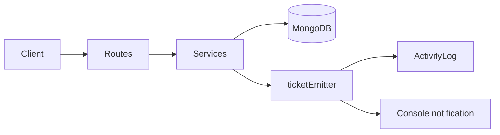

# Support Ticket Management System

Mini helpdesk application. Users raise support tickets. Administrators filter those tickets and update status and priority. Important actions are handled with a Node.js `EventEmitter` and stored in an activity log.

This submission includes the backend API and a React frontend. Search, pagination, sorting, dashboard stats, comments, events, activity logs, and demo data are included.

## Live links

| Item | URL |
| --- | --- |
| Frontend | Not deployed yet |
| Backend API | Not deployed yet |
| Health check | `GET /api/health` |

Demo accounts created by `npm run seed` if they do not already exist:

| Role | Email | Password |
| --- | --- | --- |
| Admin | admin@helpdesk.com | Admin@123 |
| User | user1@helpdesk.com | User@123 |

## Technologies

- Node.js
- Express.js
- JavaScript
- MongoDB with Mongoose
- JWT (`jsonwebtoken`) and `bcryptjs`
- Zod for input validation
- React and Vite

## Local setup

1. Install Node.js and start MongoDB locally, or use a development database connection string in `DB_URI`.
2. From the `backend` folder (Windows PowerShell):

```bash
cd backend
npm install
copy .env.example .env
# Edit .env and set a long random JWT_SECRET and your DB_URI.
# Optional: add demo accounts and sample tickets to a development database.
npm run seed
npm run dev
```

To run the frontend in another terminal:

```bash
cd frontend
copy .env.example .env
npm install
npm run dev
```

Open `http://localhost:5173`.

The API listens on `http://localhost:5000`. Vite proxies local `/api` requests to it. For deployment, set `VITE_API_URL` to the backend origin in the frontend build and set `CLIENT_URL` to the exact frontend origin on the backend. Restart/redeploy after changing these values.

Database selection uses `NODE_ENV`: `development` (the default) and `test` use `DB_URI`; `production` uses `DB_URI_PROD`. Set `NODE_ENV=production` and `DB_URI_PROD` to your Atlas connection string in your backend hosting provider's environment settings. The server fails to start if the selected URI is missing; it does not fall back to another database. Do not commit credentials or paste them into the frontend environment.

The seed adds one admin, one user and two sample tickets (one created by each) if they are missing, without deleting existing data. It does not remove data from earlier seed runs, change existing users' passwords or roles, and it stops if a demo email already belongs to a different role. Demo credentials are predictable: use them only for a disposable evaluation database, never a production system.

`.env` values:

| Variable | Purpose |
| --- | --- |
| `NODE_ENV` | `development`, `test`, or `production`; defaults to `development` |
| `PORT` | HTTP port |
| `DB_URI` | MongoDB connection string for development and tests |
| `DB_URI_PROD` | MongoDB connection string for production |
| `JWT_SECRET` | Secret used to sign tokens |
| `JWT_EXPIRES_IN` | Token lifetime, default `7d` |
| `CLIENT_URL` | Allowed browser origin for CORS |

## Architecture

Frontend code is organized under `frontend/src`: `main.jsx` starts the app, `App.jsx` manages the dashboard, `components/` contains the UI, `services/` contains the API client, and `utils/` contains shared ticket helpers.

```
routes -> controllers -> services -> models
                |
                v
         ticketEmitter.emitAsync(...)
                |
                v
         ActivityLog + console notification
```



Services emit an event only after the database write succeeds. Listeners are registered with `ticketEmitter.on`. `emitAsync` runs those listeners and waits for them. A listener failure is logged and does not change the HTTP result of the original action. Events are in-memory and best-effort: a process crash or database failure can leave an activity entry missing. A durable queue or transactional outbox would be needed for guaranteed delivery.

| Event | When it fires | Activity action |
| --- | --- | --- |
| `ticket:created` | A ticket is saved | `CREATED` |
| `ticket:updated` | A user edits an open ticket, or an admin changes priority | `UPDATED` |
| `ticket:status_changed` | An admin changes status | `STATUS_CHANGED` |
| `ticket:resolved` | The new status is `RESOLVED` | `RESOLVED` |
| `ticket:commented` | A user or admin adds a comment | `COMMENTED` |

`ticket:resolved` is emitted in addition to `ticket:status_changed`.

## Access rules

- `POST /api/auth/register` accepts `name`, `email`, and `password` only. The saved role is always `USER`. The admin account is created by the seed script.
- A user can list, open, comment on, edit, and delete only their own tickets.
- Edit and delete are allowed only while the ticket status is `OPEN`.
- A user cannot change `status` or `priority`.
- An admin can list and open every ticket, filter by `status` and `priority`, and update `status` and `priority`.
- Users and admins can comment on accessible tickets that are not `CLOSED`.
- A ticket id that the caller cannot access returns `404`, so other users' tickets are not revealed.
- Passwords are hashed with bcrypt and are excluded from API responses.

## Database design

Four collections:

**User:** `name`, `email` (unique), `password`, `role` (`USER` or `ADMIN`).

**Ticket:** `title`, `description`, `category` (`TECHNICAL`, `BILLING`, `ACCOUNT`, `GENERAL`), `priority` (`LOW`, `MEDIUM`, `HIGH`, `URGENT`), `status` (`OPEN`, `IN_PROGRESS`, `RESOLVED`, `CLOSED`), `createdBy`, optional `assignedTo` (reserved for future assignment support).

**Comment:** `ticketId`, `userId`, `message`, `createdAt`.

**ActivityLog:** `ticketId`, `actorId`, `action` (`CREATED`, `UPDATED`, `STATUS_CHANGED`, `COMMENTED`, `RESOLVED`), `details`, `createdAt`.

Relationships:

- One user creates many tickets (`Ticket.createdBy`).
- One ticket has many comments and many activity logs.
- Each comment and log stores the acting user.

Indexes:

- `User.email` unique, for login and to block duplicate registration.
- `Ticket` `{ createdBy, status }`, for each user's list.
- `Ticket` `{ status, priority }`, for the admin filter.
- `Comment` and `ActivityLog` `{ ticketId, createdAt }`, for the ticket detail timeline.

Deleting an `OPEN` ticket also deletes its comments. Activity logs for that ticket are kept.

## API summary

Send the token as `Authorization: Bearer <token>`.

| Method | Path | Who | Body / query |
| --- | --- | --- | --- |
| POST | `/api/auth/register` | Public | `name`, `email`, `password` |
| POST | `/api/auth/login` | Public | `email`, `password` |
| POST | `/api/tickets` | User or Admin | `title`, `description`, `category`, optional `priority` |
| GET | `/api/tickets` | User sees own; Admin sees all | Optional `status`, `priority`, `search`, `sortBy`, `sortOrder`, `page`, `limit` |
| GET | `/api/tickets/stats` | User or Admin | Role-based ticket counts |
| GET | `/api/tickets/:id` | Owner or Admin | Ticket, comments, and activity |
| PATCH | `/api/tickets/:id` | Owner while `OPEN` | `title`, `description`, `category` |
| PATCH | `/api/tickets/:id` | Admin | `status`, `priority` |
| DELETE | `/api/tickets/:id` | Owner while `OPEN` | — |
| POST | `/api/tickets/:id/comments` | Owner or Admin | `message` |
| GET | `/api/health` | Public | — |

Successful responses use `{ "success": true, "data": ... }`. Failures use `{ "success": false, "message": ... }`.

List results have `data.tickets` and `data.pagination` (`page`, `limit`, `total`, `totalPages`). `limit` defaults to 10 and is capped at 50. Sort fields are `createdAt`, `updatedAt`, `priority`, or `status`, with `asc` or `desc` order.

Postman collection: [docs/helpdesk.postman_collection.json](docs/helpdesk.postman_collection.json).

## Scripts

| Command | What it does |
| --- | --- |
| `npm run dev` | Starts the API with nodemon |
| `npm start` | Starts the API with node |
| `npm run seed` | Adds one demo admin, one demo user and two sample tickets if missing |
| `npm test` | Runs smoke and isolated MongoDB integration tests |

The integration tests use `mongodb-memory-server`, not `DB_URI`. The first run may need to download a MongoDB binary. Run `npm run build` in `frontend` to verify the production frontend build.
